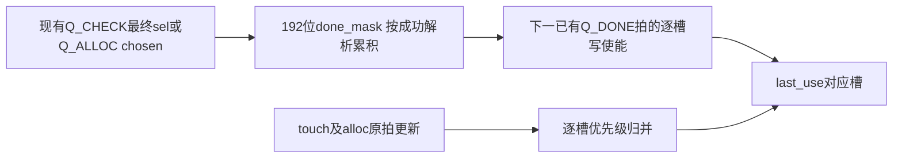

# A+B 缓存时序改进设计方案

日期：2026-10-24。状态：设计审阅稿，尚未实施。目标是在冻结A+B算法和外部契约下，缩短缓存元数据更新的布线路径；本轮不修改源码。

## 1 建议及范围

推荐候选P1：将`last_use`组织为逐槽静态更新表达，并在现有`Q_CHECK/Q_ALLOC`成功解析每个邻域键时，累积192位`done_mask`。`Q_DONE`使用已寄存的掩码更新对应槽，不再在结束拍用四个二进制qid分别动态寻址整个时间戳数组。

首轮只计划修改隔离副本的`undistort_cache_ab.v`，增加配套验证文件。`undistort_core.v`、map、bilinear、corr_top、DDR桥、宿主、UART、FDC、IP不改。保留每奇偶集合96项、64像素段、24KiB共享图像RAM、前瞻256和坐标FIFO512；不引入G8/FIFO16或新的映射流水。

这是**待批准的结构变换**。保持接口、周期和逻辑结果是设计要求，尚不是经过实现验证的事实。若首轮失败，应按报告判断下一步，不能自动扩大到映射、淘汰算法或时钟约束。

## 2 基线事实与瓶颈

来源为已交付AB新哈希seed2整机物理诊断：PDS SP6.1 build138931，PG2L100H/FBG676/-6，125MHz。所用11份源码／报告已与原交付清单核对，详见`evidence/source_identity.json`。

| 项目 | 已有实测 |
|---|---:|
| Setup Slow WNS，CSV/RTR | −2.585ns |
| Setup Slow WNS，holdfix视图 | −2.496ns |
| Setup Fast WNS，CSV | +1.289ns |
| Hold Slow / Fast，CSV | +0.059 / +0.044ns |
| 慢角TNS／违规端点 | −2995.861ns／4630 |
| 最差路径数据延迟 | 10.016ns |
| 其中逻辑／布线 | 0.935ns／9.081ns |

最差原生路径为`u_cache/qid[3][5]`到`last_use[186][15]/CE`，相同起点到`[19]/CE`也为−2.585ns；另一条`qid[0][5]→last_use[107][7]/I3`为−2.474ns。因此要观察写使能及数据/反馈路径，不能只检查CE端点。

原生最差路径的5段数据网延迟为1.430、3.122、0.617、1.369、2.543ns，合计9.081ns；其中3.122和2.543ns占布线延迟约62.4%。这两段的扇出分别是12、11；起点数据网扇出19。证据说明长布线占主导，**不能据此声称qid数据网存在几千扇出**。报告中的2158/2011是时钟分支扇出。

只在其他时序项完全不变的算术假设下，数据路径需从10.016ns降到不超过7.431ns；若只减少布线，需减少至少2.585ns，约为当前布线延迟的28.5%。这不是布局预测；变换后逻辑、时钟偏斜和布线都会变化。

当前选取的路径JSON只有3条负slack路径，不能代表4630个违规端点全由这一逻辑造成。旧综合map宽乘法瓶颈仍是风险，本方案不保证整机一次闭合。

## 3 源码行为及必须保留的语义

以下行号对应本包`reference/frozen_rtl/undistort_cache_ab.v`，原件未改：

| 行号 | 当前行为 | 改动时必须保留 |
|---|---|---|
| 66 | `last_use[0:191]`，每项22位 | 保持接口与逻辑位宽，不根据综合优化擅自缩位 |
| 223–227 | touch的四个动态索引写同一个i_touch_seq | 重复ID同值写可以合并；非重复槽必须全部写入 |
| 250–258 | Q_SELECT为四键产生qid/qfound | qfound可包含尚未轮到Q_CHECK处理的命中槽 |
| 260–269 | Q_CHECK合并重复邻域，使用最终sel | 新掩码必须记录本拍解析的sel，不能记录NBA更新前的旧qid |
| 271–281 | Q_ELIG按qfound/qid保护，检查pending和last_use | 保留全部四个qfound/qid的保护以及原快照时刻 |
| 137–142、283–300 | 分组淘汰树 | 相同age时older选择第二操作数；保持原树顺序，不改成最小ID或近似LRU |
| 302–311 | Q_ALLOC成功后写tag、pending、last_use、fetch FIFO、qid | last_use的分配拍写入不得取消或延后 |
| 313–317 | Q_DONE写四qid的last_use，发布IDs/done并回IDLE | done、输出IDs、busy释放及last_use更新时间保持同拍 |

数组语句共有4个touch、1个alloc、4个done更新位置，不代表9个独立同时生效的物理写端口。alloc与done状态互斥；同槽冲突时，原always块后执行的alloc/done写覆盖touch。不能用`max(last_use,seq)`替代，也不能反转优先级。

`Q_ELIG`同拍发生touch时，非阻塞赋值使其读到沿前last_use。这一行为必须原样保持，不在本轮顺带修正或新增forwarding。原last_use没有逐项复位/清零赋值，新实现也不能加清零RAM或全数组复位，造成不必要资源和语义变化。

## 4 推荐结构 P1

### 4.1 逐槽更新归并

对每个静态槽i（0到191），定义：

- `touch_i`：i_touch有效，四个i_touch_ids中至少一个等于i。
- `alloc_i`：Q_ALLOC且chosen_ok，chosen等于i。
- `done_i`：Q_DONE且done_mask[i]。

在原有效分支内（非reset、非frame_clear）执行：

1. 若alloc_i或done_i，写qseq。
2. 否则若touch_i，写i_touch_seq。
3. 否则保持。

这是语义公式，不是本次交付的RTL。未来实现应删除原来三个位置对last_use的赋值，再由每项唯一的时序驱动者执行；不能保留旧写语句造成多驱动。是否采用generate或保持单always由实现确定，必须保持相同沿前读取和写入优先级。

这一表达把一个槽的比较/写使能/数据选择放到明确的局部逻辑中，但综合器可能已做类似化简；单纯重写语法不承诺物理收益。

### 4.2 在已有状态内累积完成掩码

引入192位`done_mask`，只用于Q_DONE的时间戳更新：

| 事件 | 掩码动作 |
|---|---|
| rst_n复位 | 清零新增掩码；不改变原last_use复位行为 |
| i_frame_clear | 清零，并保持原状态/队列/有效位清理优先级 |
| Q_SELECT | 清零，开始本轮四邻域解析 |
| Q_CHECK且最终found为真 | 将本拍最终sel对应的一位置1，其余保持 |
| Q_ALLOC且chosen_ok | 将本拍chosen对应的一位置1，其余保持 |
| miss、等待无可淘汰槽、其他状态 | 保持，不新增任何位 |
| Q_DONE | 使用当前掩码写last_use；掩码可保持直到下一轮Q_SELECT |

最后一个键在Q_CHECK成功或Q_ALLOC成功的边沿完成置位，并进入Q_DONE；下一边沿才执行Q_DONE，因此新增位有完整一拍可见，不需要加WAIT状态。

可在源码层按12组×16个连续ID组织局部更新，对应原先每组8个奇数槽＋8个偶数槽。首轮不加入PAP_GROUP或强制LOC。源码分组本身不是实际物理邻近的证明；PNR后必须确认掩码寄存器与受控last_use是否局部放置。

预期减少的是“Q_DONE时四qid动态译码、合并后驱动大量last_use位”的路径。新路径`sel/chosen→done_mask`以及`done_mask→last_use`仍需时序检查；不能把同一复杂译码简单移到另一个寄存器后就宣称问题解决。

### 4.3 全命中逐拍例子

以接收i_lookup_req的上升沿为E0，表中动作使用该沿前状态，结果在NBA后可见：

| 边沿 | 原状态 | 原动作 | 新增掩码动作 |
|---|---|---|---|
| E0 | Q_IDLE | 锁存查询，进入MATCH | 无 |
| E1 | Q_MATCH | 寄存匹配组 | 无 |
| E2 | Q_SELECT | 锁存qid/qfound，qwhich=0 | 清零 |
| E3 | Q_CHECK键0 | 解析最终ID0 | 置ID0 |
| E4 | Q_CHECK键1 | 解析最终ID1 | 置ID1 |
| E5 | Q_CHECK键2 | 解析最终ID2 | 置ID2 |
| E6 | Q_CHECK键3 | 解析最终ID3，进入DONE | 置ID3 |
| E7 | Q_DONE | 更新时间戳，输出IDs和done，回IDLE | 使用完整掩码 |

这里受理到done有效为7个边沿间隔；是源码状态推导，不是新仿真实测。缺失键沿用Q_ELIG→Q_GROUP→Q_VICTIM→Q_ALLOC原流程，失败重试也沿用原流程，不加状态/周期。方案不改变像素采样II=2、core退休管线或prepared队列。

### 4.4 等价性论据及一个重要禁区

不变量：已成功处理前k个键后，done_mask等于这k个键最终ID的集合；成功解析下一键只做集合并。进入Q_DONE时四键全部处理完，因此掩码恰为四个最终qid的集合。所有Q_DONE写入值均为qseq，所以重复ID合并为一次同值写不改变结果。

证明依赖：用最终sel/chosen置位、每次Q_SELECT清零、原qfound/qid保护不动、正确处理reset/clear及所有重试。抽象集合论据不能替代RTL实现证明。

**禁止拿done_mask替换Q_ELIG的protected_id。** 例：qwhich=0的键缺失，但Q_SELECT已经发现键1命中槽20。槽20尚未经过Q_CHECK，因此done_mask可仍为空；原qfound[1]/qid[1]已在保护槽20。若只用done_mask淘汰保护，可能错误覆盖这个尚未处理的命中槽。

## 5 接口、资源与性能影响

| 维度 | 方案要求／估算边界 |
|---|---|
| 模块端口与位宽 | 不变；不增加ready/valid或新UART位域 |
| 查找与输出延迟 | 目标逐拍等价，不增加状态或完成拍 |
| 淘汰、预取与DDR请求轨迹 | 目标相同输入下逐拍一致；不是只保证最终图像相同 |
| RAM结构 | 24KiB图像RAM不变；cache仍以8个DRM36K为基线，预算≤12不变 |
| DSP/APM | 没有新增乘法设计，目标新增APM为0；以实际报告为准 |
| 新增状态量 | 一个192位mask；不是四个192位mask（768位） |
| FF粗估 | 192个逻辑位约为基线cache8084FF的2.38%；最终增量会受综合合并/复制影响，不承诺恰好+192FF |
| LUT | 新增掩码译码也可能减少原更新网络；无实测，不提供虚构LUT增减 |
| 其他待解决事项 | map路径、touch/alloc路径、tag匹配、victim树、未约束I/O、电气问题不因此消失 |

原last_use声明为192×22=4224位，综合网表识别4032个DFF_E；原生位数可能受优化影响，本方案不据此修改22位语义。

既有共享压力点为4,161,672周期，假设125MHz约30.036fps，距30fps周期预算仅约4,994.7周期。额外查找气泡即使只增加一拍，也不能先验认为完全被前瞻隐藏。选择P1的原因之一是要求零新增状态周期；不保证布局后的真实帧率。原≤2cpp检查仍失败，不降低门槛。

## 6 备选路线与推荐次序

| 路线 | 收益机制 | 主要风险 | 建议 |
|---|---|---|---|
| P0 仅逐槽归并，无新mask | 显式约束写入优先级和局部逻辑，零新增状态 | 可能与原综合等价，仍有qid全局译码 | 可作P1验证阶段的中间提交；不要求为语法变化额外跑全帧/PNR |
| P1 逐槽归并＋解析期done_mask | 将结束拍的qid译码提前到已有状态，减少完成写入控制的长路径 | sel/chosen→mask、mask清零或touch成为新关键路径；局部放置未必实现 | 首选隔离候选，先证明逐拍等价再做同seed诊断 |
| P2 时间戳写入加一拍／更多流水 | 切断长组合路径 | last_use可见性、eligibility快照、退休保护需旁路或重定时，可能影响周期及替换轨迹 | 本轮不推荐；P1不足后另行论证和裁定 |
| P3 last_use改BRAM、近似LRU或组相联 | 可能减少触发器／全相联逻辑 | 现有四ID更新和96项并行age读取不适配简单双口BRAM；替换/命中/DDR轨迹变化 | 不纳入首轮范围，不用“等价优化”名义实施 |
| P4 仅布局分组／寄存器复制 | 改善物理邻近性 | 层级可能被展平，约束需工具支持及覆盖证据；无法保证路由改善 | 首轮保持FDC不变；若需此路线单独给出约束diff和依据 |

## 7 设计风险与停止条件

1. 若掩码只累积旧qid、最后一位晚一拍、clear未清理或提前发布done，应直接判功能失败，回退。
2. 若改动涉及core、map、FDC、缓存容量、FIFO、退休阈值、tie规则或DDR契约，已经超出P1范围，先回传协商。
3. 若发现基线异常行为，单独记录并提出修复；不能在时序变换中默改，导致无法证明与冻结输入的关系。
4. 若功能逐拍等价但PNR未改善，应报告实际新瓶颈和资源变化，不能宣布125MHz通过或继续盲扫种子。
5. 本轮基线存在UART自动放置及bank电平不兼容问题。仅作离线时序诊断，不生成可下载位流；最终上板需独立完成E02。

具体实施门禁、回退点和设计方请求见其余两份文件。
