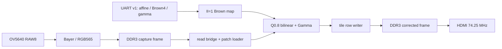

# 紫光 PG2L100H 1080p30 任意角度畸变校正

本工程面向 PG2L100H-6 FBG676，输入 OV5640 1920×1080 RAW8，经过原有摄像头初始化、Bayer/RGB565、DDR3 帧缓存、校正帧缓存后输出 HDMI 1920×1080。校正数据路径已独立重写；旧工程的低吞吐逐行缓存核心没有接入生产路径。

2026-10-29 的 `release/board_acceptance.json` 记录了该位流在 PG2L100H 上的 SRAM/JTAG 板测。该记录验证校正帧发布吞吐和棋盘直线度；没有独立计数相机输入与 HDMI 输出的不同帧身份，因此不据此声称端到端无丢帧的 30 个不同画面/秒。

## 已完成的实现

- Brown 二阶径向加切向模型（Brown4），使用真实 OV5640 标定数据 `calibration/ov5640_1080p.json`。
- 定点坐标映射：Q28 线性项、Q20 偏置/归一化、Q22 畸变系数、Q16 源坐标；`brown_map` 为 II=1 流水结构，32×32 投影乘法显式拆分为 4 个 16 位部分积并寄存。
- 64×32 输出 tile，三组坐标上下文；逐像素映射 AABB（含双线性右/下邻点），双 256×256 RGB565 patch、四奇偶 bank 和 Q0.8 双线性插值。
- 取块、坐标计算、渲染、DDR 写回重叠执行；输出 tile 行直接写最终画面地址，避免旧方案的整幅 stripe 拷贝。
- 目标帧写满、原生 DDR `LAST` 排空、commit 后才发布；显示帧只在 HDMI 帧界切换。
- 上位机可发送旋转、缩放、平移和剪切。变换是平面仿射输出到输入映射，不能宣称 IMU 3D 姿态或完整透视矫正。
- UART 配置使用影子寄存器和帧界原子切换。默认上电即使用真实标定参数；上位机不是出图的前置条件。
- 自适应 Gamma 0.6/1.0/1.6，基于上一帧有效像素均值并带滞回；无效源点输出黑色。



## 标定数据

数据来自用户提供的 30 张拟合姿态和 5 张独立验证姿态。内参约为 `fx=1507.7104`、`fy=1507.4035`、`cx=883.5331`、`cy=568.6877`，畸变系数 `k1=-0.3814826`、`k2=0.1566984`、`p1=-0.0003030`、`p2=-0.0001110`，`k3=0`。原始照片清单及 SHA256 来自 `D:\FPGA\photo\session_203513\SESSION.json`，工程不复制照片到仓库。

## 软件使用

```powershell
cd D:\restart\fpga-undistort
python -m pip install -r requirements.txt
python host/control.py preflight --angle 45 --auto-crop
python host/control.py preview --input D:\FPGA\photo\session_203513\pose_031_validation_center_yaw_left\source.png --output reports\preview_pose031.png --angle 45 --auto-crop
python host/control.py ports
python host/control.py send --port COM11 --angle 45 --auto-crop
python host/control.py monitor --port COM11 --seconds 10 --output reports\board_fps.json
python host/gui.py
```

上位机的“连续动态仿射”支持旋转与剪切倾斜的平滑往返运动。启动时会预检完整轨迹并固定自动裁剪倍率；运行期间依据实测的配置帧界生效延迟预测未来角度，额外提前量默认为 0 ms。数学检查：`python tools/check_motion.py`；使用说明见 `MOTION_CONTROL.md`。该预测只能补偿主机到 FPGA 配置生效延迟，不能替代相机、HDMI 和采集卡的端到端运动帧率板测。

`--auto-crop` 会提高缩放以使 1920×1080 所有输出点都有源样本；它会裁掉视野，不能恢复相机没拍到的区域。手动 zoom 更大时会保留用户给出的更大值。GUI 的连接按钮才会打开串口，离线预览不打开硬件。

## 仿真与 PDS

质量分析和绘图需额外安装 `python -m pip install -r requirements-analysis.txt`。ModelSim 运行器为 `tools/run_sim.py`，每次运行建立时间戳目录，保存输入 SHA256 和显式 PASS 回执。常用检查：

```powershell
python tools/check_map.py
python tools/check_native.py --angle 45 --latency 40
python tools/check_native.py --angle 0 --next-angle 45 --latency 40
python tools/check_real_rtl.py
python tools/run_sim.py adaptive_gamma_tb source/rtl/adaptive_gamma.v sim/adaptive_gamma_tb.v
python tools/run_sim.py frame_ownership_tb source/rtl/frame_bank_ctrl.v source/rtl/corr_slot_ctrl.v sim/frame_ownership_tb.v
python tools/check_host.py
python tools/profile_angles.py --step 5
python tools/check_real_images.py
python tools/plot_quality.py
python tools/run_verification.py
```

PDS GUI 工程为 `pango_undistort.pds`；批处理快照由 `tools/build.py` 创建：

```powershell
python tools/create_project.py
python tools/build.py --name release --seed 1
```

同一源码的正式种子 1、2、3 已完成 `Design Summary : All Constraints Met.`。`build/pds/<name>/receipt.json` 将 `timing_passed` 与输入 manifest 绑定。PDS 使用 `HDMI_DDR3_OV5640_test.fdc` 的板级时钟、摄像头/HDMI 约束，以及 UART B24/C24 管脚证据。没有用 false path 覆盖校正计算路径；仅 UART 异步输入到同步器入口设为 false path。

## 资源和时序证据

PDS 2022.2-SP6.4、PG2L100H-6 FBG676，正式 seed 1：LUT 9,786/66,600（14.69%），FF 13,209/133,200（9.92%），APM 60/240（25.00%），DRM 84.5/155（54.52%）。该余量为稳定和后续功能预留，并非为了评分刻意压缩资源。

125 MHz DDR application domain 的 seed 1/2/3 slow-corner setup WNS 分别为 +0.329 ns / +0.406 ns / +0.593 ns，报告中还加入了 0.4 ns setup uncertainty；hold/recovery/removal 无失败端点。3 个种子均通过同一组约束。交付位流选用 setup 余量最大的 seed 3：`release/pango_undistort.sbit`，身份及 SHA256 见 `release/manifest.json`。对应构建快照在 `build/pds/release_seed3/`，完整 PDS 报告压缩存于 `reports/pds/`。

ModelSim 原生视频流同时运行 nominal capture/display traffic，周期预算为 4,166,666（30 fps@125 MHz）：

| 场景 | 周期 | 等效处理能力 | 结果 |
|---|---:|---:|---|
| 0° 真实 Brown4 | 2,103,246 | 59.43 fps | 2,073,600 像素逐点通过 |
| 45°，zoom=1 | 3,431,845 | 36.42 fps | 逐点通过 |
| 90°，zoom=1 | 2,950,778 | 42.36 fps | 逐点通过 |
| 90°，auto-crop zoom≈1.7063 | 2,139,454 | 58.43 fps | 逐点通过 |
| 45°，更密 background period=430 | 3,521,619 | 35.50 fps | 逐点通过 |
| 0°→45° 连续两帧并在帧中改配置 | 2,103,246 / 3,432,312 | 59.43 / 36.42 fps | 两帧逐点通过 |

上述是 RTL/DDR broker 仿真能力，不是实板帧率。完整压力场景的 `read_wait` 会明显增大，这正是将 DDR 争用计数公开到状态寄存器的原因。

## 实拍离线结果

`tools/check_real_images.py` 使用 5 张独立验证 PNG，比较原图、生产定点 RGB565 模型和浮点参考；结果在 `reports/real_image_quality.json`，图表在 `reports/real_images/quality_summary.png` 和 `sfr_curves.png`。定点模型与浮点参考约 53.7–54.2 dB PSNR；棋盘直线度 RMS 从 0.666–1.228 px 降到 0.053–0.117 px。SFR 是倾斜棋盘边缘的比较性估计，未宣称 ISO12233 认证 MTF50；校正还会改变边缘采样和视场，因此应以同一姿态、同一裁剪方式比较。

`tools/check_real_rtl.py` 把 pose_031 的真实 PNG 转成 RGB565 源帧，经生产 tile_engine、read/write bridge、DDR broker 仿真，2,073,600 个输出像素与预计算黄金帧一致。这仍是离线仿真。

## 串口协议

帧格式：`AA 55 | version=1 | command | payload_len | seqLE16 | payload | CRC16LE`，CRC 为 CCITT-FALSE，覆盖 version 到 payload 末尾。`SET=0x10` 的 payload 是 16 个 signed32 little-endian 寄存器（64 字节）；`STATUS=0x20` 返回 `0xA0`、48 字节 telemetry，magic 为 `0x554E4401`。状态包括 active/pending sequence、发布帧计数、周期、读写等待、读拍数、无效像素、patch 越界、错误计数和 Gamma mode。旧仓库串口工具不兼容。

## 硬件验收边界

2026-10-29 已在 PG2L100H 上验证发布位流：5个常用场景实测29.977–30.002个新校正帧/秒，45°连续180秒达到29.996 fps；24个每15°角度命令全部在帧界生效。11×8实物棋盘直线RMS由未校正2.674 px降至0.115 px，返回未校正为2.689 px。板测方法、受限项和证据见 `BOARD_TEST.md`、`PERFORMANCE_REPORT.md` 和 `release/board_acceptance.json`。实板端到端延迟及芯片温度仍未测；PDS配置状态的over_temp标志原因未知。

按用户要求重新摆放棋盘格后又完成一轮复测：重新上电并下载同一位流，旁路/校正/旁路均为30.034 fps，棋盘直线RMS中位数为2.881/0.159/2.871 px，九帧均检测到全部88点。断电期间采到的全黑画面未用于分析。详见板测记录。

## 许可证和来源

板级基础、DDR、摄像头、HDMI 和厂商 IP 来自用户授权的私有参考仓库固定 commit，详见 `THIRD_PARTY.md`。本仓库保持私有；未经权利人授权不要公开包含厂商 IP 的内容。


## 报告索引和结果边界

- `PERFORMANCE_REPORT.md`：架构、吞吐、资源和质量分析。
- `PROTOCOL.md`：串口字节格式、16 个定点寄存器与状态字段。
- `BOARD_TEST.md`：硬件重新连接后的步骤与验收记录。
- `release/board_acceptance.json`：与发布位流SHA绑定的实际帧率、动态角度及棋盘直线度验收摘要。
- `reports/verification_summary.json`：最终软件套件输入哈希、19 次 ModelSim 运行和 15 条检查命令。
- `reports/pds_seed_summary.json`：3 个相同输入种子的资源、时序和位流身份。

系统采用整帧缓存；当前仿真中“完整源帧可用→校正帧发布”约 16.83–28.17 ms，真实输入采集和 HDMI 等待/扫描还会增加延迟。未经板测不能给出端到端延迟实测值。GUI 自动发送为停止拖动 500ms 后提交最新值，串口可在帧间更新矩阵；没有宣称每秒 30 次完整交互命令。
